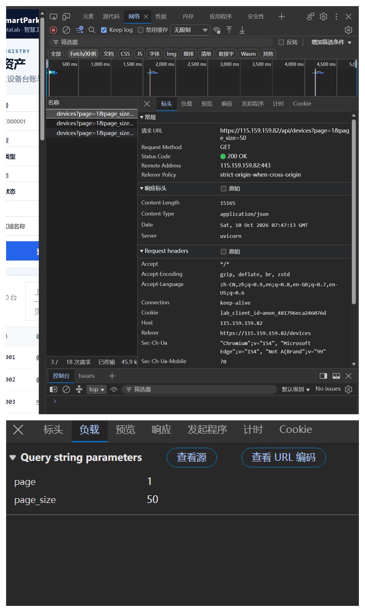
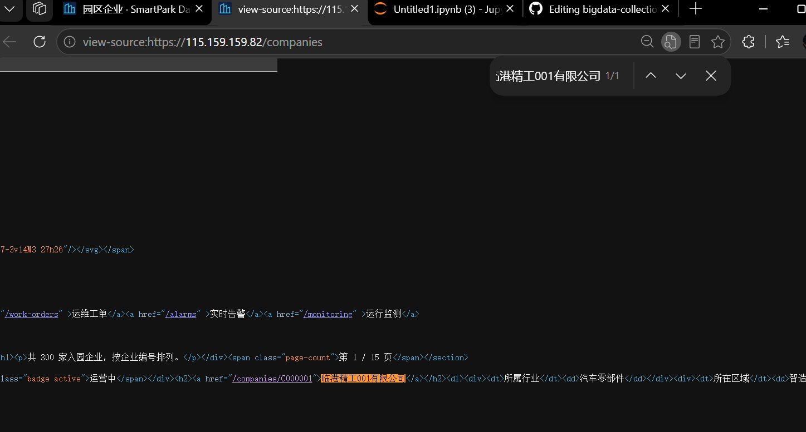
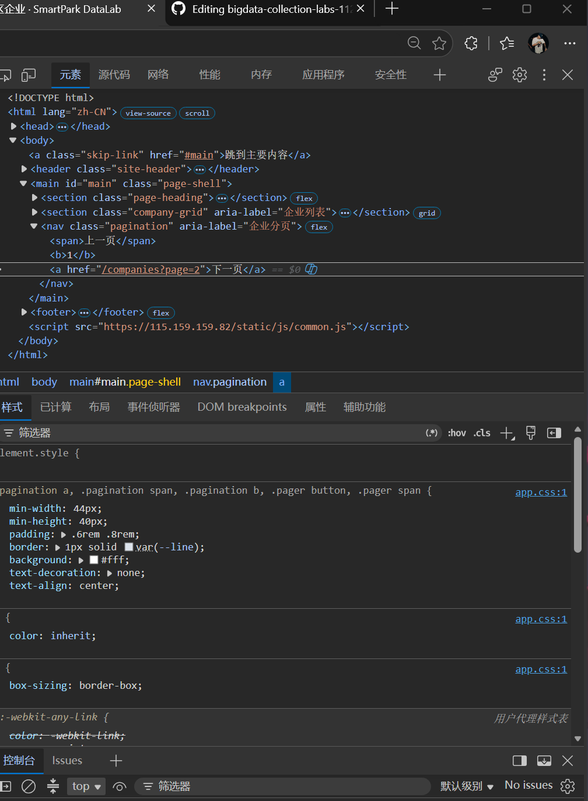
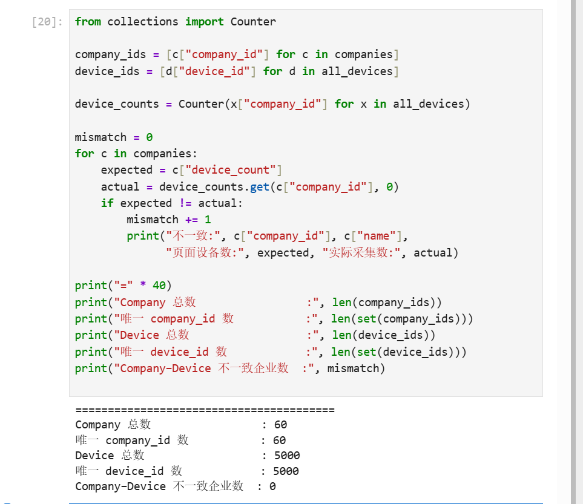

# Lab 1 实验报告

## 学生信息

- **姓名：** 崔睿
- **学号：** 112404260121
- **班级：** 数据1241
- **GitHub 用户名：** CCR-CR-RRRC
- **仓库地址：** https://github.com/CCR-CR-RRRC/bigdata-collection-labs-112404260121

> 文件位置：`lab01/REPORT.md`  
> 完整代码保存在 `lab1_html_api.ipynb`。  
> 本报告只填写关键发现、关键代码、结果和指定截图，**不要把整份 Notebook 复制进来**。

---

# 任务 1：判断数据加载方式

## 1.1 Device：判断动态加载并找到 API

### 判断结果

- 页面：`/devices`
- 数据加载方式：**动态加载**
- 判断依据：

在“查看网页源代码”中用 `Ctrl + F` 搜索页面上真实存在的设备编号（如 `D00000001`），搜索结果为 0 条，说明设备数据并未随初始 HTML 一起返回；随后在 `F12 → Network → Fetch/XHR` 中刷新页面，找到了返回设备列表 JSON 的请求，故判定 `/devices` 为**动态加载**。

### API 信息

- Request URL：`https://115.159.159.82/api/devices`
- Request Method：`GET`
- Query 参数：`page`（页码）、`page_size`（每页条数，页面默认为 50）

### 【截图 1】Device API 发现证据



---

## 1.2 Company：判断静态加载

- 页面：`/companies`
- 数据加载方式：**静态加载**
- 判断依据：

在“查看网页源代码”（`Ctrl + U`）中用 `Ctrl + F` 搜索页面上真实显示的企业名称（如“临港精工001有限公司”），可以直接命中，且企业卡片的完整 HTML（含企业编号 `C0000001`、所属行业、设备数量等）都写在初始 HTML 里，说明企业数据是随 HTML 一起由服务器直接返回的，不需要额外的 API 请求，故判定 `/companies` 为**静态加载**。

### 【截图 2】Company 静态加载证据



---

# 任务 2：Device API 分页采集

## 2.1 API 分页结构

填写你实际从 JSON 中观察到的字段：

| 含义 | JSON 字段 |
|---|---|
| 当前页 | `page` |
| 每页条数 | `page_size` |
| 设备总数 | `total` |
| 设备列表 | `items` |

---

## 2.2 关键代码

只填写分页采集的核心部分，不要粘贴整个 Notebook。

```python
# 从第一页响应中读取分页信息
total = data["total"]
page_size = data["page_size"]

total_pages = (total + page_size - 1) // page_size

devices = []

for page in range(1, total_pages + 1):
    r = requests.get(
        api_url,
        params={
            "page": page,
            "page_size": page_size
        },
        timeout=10
    )

    page_data = r.json()
    page_items = page_data["items"]
    devices.extend(page_items)
```

---

## 2.3 采集结果

- 每页条数：50
- 设备总数：5000
- 程序计算得到的总页数：100
- 最终采集设备数：5000
- 唯一 `device_id` 数：5000

回答：

> 为什么总页数应由 API 返回的 `total` 和 `page_size` 计算，而不是直接在代码里写死？

答：写死总页数的前提是“数据总量和每页条数永远不变”。一旦平台新增设备（如 total 变成 5001）或调整每页条数，写死的页数就会漏采后面的数据（页数偏小）或产生多余空请求（页数偏大）。用 `total` 和 `page_size` 动态计算总页数，程序能自动适应数据量的变化，代码更健壮、可复用。

---

# 任务 3：Company HTML 解析

## 3.1 企业记录 Selector

- 企业记录 selector：`article.company-card`
- 第 1 页企业记录数：20

说明为什么选择这个 selector：

- 主要使用了 `id / class / data-* / 父子层级` 中的哪一种？
- 是否参考过浏览器 Copy selector 或 AI？
- 最终为什么采用现在这个写法？

答：主要用了 `class` + `data-*`。每张企业卡片是一个 `<article>` 元素，带有统一的 `class="company-card"` 和唯一标识 `data-company-id`，语义清晰、定位范围精确，既不会误抓页面其它 `<article>`，还能直接从属性里取到 `company_id`。我没有用浏览器 Copy selector 生成的长路径（层级太深，页面结构稍变就失效），而是采用最短、最稳定的 `article.company-card`。

---

## 3.2 关键代码

只填写“记录定位 + 一条记录的关键字段”。

```python
cards = soup.select("article.company-card")

card = cards[0]

company_id = card["data-company-id"]
name = card.select_one("h2 a").get_text(strip=True)
status = card.select_one(".badge").get_text(strip=True)
```

行业、区域、设备数量使用 `dt/dd` 结构后，请写出你最终如何得到：

```python
# dd(field) 为自定义辅助函数：遍历 card.select("dl > div")，
# 找到 <dt> 文本与 field 相同的 <div>，返回其中 <dd> 的文本
industry = dd("所属行业")
zone = dd("所在区域")
device_count = int(dd("设备数量").replace("台", "").strip())
```

---

## 3.3 字段来源说明

任选 **2 个字段**说明：

1. 字段：`company_id`
   - 来自：`HTML 属性`
   - 使用的方法：每张卡片的 `<article>` 上带有 `data-company-id="C000001"` 属性，用 `card["data-company-id"]` 直接读取属性值。

2. 字段：`name`（企业名称）
   - 来自：`文本`
   - 使用的方法：企业名在 `<h2><a href="...">临港精工001有限公司</a></h2>` 的链接文本里，用 `card.select_one("h2 a").get_text(strip=True)` 取出文本并去掉首尾空白。

---

# 任务 4：Company “下一页”分页

## 4.1 下一页元素

- “下一页” selector：`nav.pagination a`（在结果中再按链接文本筛选出“下一页”那一个）
- 第 1 页 `href` 示例：`/companies?page=2`

### 【截图 3】Company “下一页”元素



---

## 4.2 关键代码

```python
next_link = None
for a in soup.select("nav.pagination a"):
    if a.get_text(strip=True) == "下一页":
        next_link = a
        break

next_href = next_link["href"]

next_url = urljoin(
    current_url,
    next_href
)
```

再用 2～3 句话说明：

> 你的程序如何完成“当前页 → 找下一页 href → 请求下一页 → 再解析”的循环？

答：先取出分页区（`nav.pagination`）里所有 `<a>`，按链接文本“下一页”筛选出目标链接，取出 `href` 用 `urljoin` 拼成完整 URL 再次请求；对新页面重复“解析卡片 → 找下一页”，循环 3 次采满前 3 页。之所以要按文本筛选而不能直接取第一个 `<a>`，是因为从第 2 页起“上一页”也变成了 `<a>` 元素（第 1 页它是 `<span>`），直接取第一个会退回上一页、造成重复采集（实测出现过 60 条中 20 条重复）。

---

## 4.3 三页采集结果

| 页码 | 企业数 |
|---|---:|
| 1 | 20 |
| 2 | 20 |
| 3 | 20 |
| **合计** | **60** |

- 唯一 `company_id` 数：60

---

# 任务 5：结果验证

## 5.1 最终结果

| 检查项 | 结果 |
|---|---:|
| Company 总数 | 60 |
| 唯一 `company_id` | 60 |
| Device 总数 | 5000 |
| 唯一 `device_id` | 5000 |
| Company–Device 不一致企业数 | 0 |

### 【截图 4】最终验证结果



---

## 5.2 一致性检查关键代码

只填写最关键的比较逻辑：

```python
from collections import Counter

device_counts = Counter(
    x["company_id"] for x in all_devices
)

mismatch_count = 0

for company in companies:
    cid = company["company_id"]
    expected = company["device_count"]
    actual = device_counts.get(cid, 0)

    if expected != actual:
        mismatch_count += 1
        print("不一致:", cid, company["name"],
              "页面设备数:", expected, "实际采集数:", actual)
```

回答：

> 为什么 `status_code == 200` 仍然不能说明“数据已经采集正确”？

答：`200` 只代表服务器成功响应了这一次 HTTP 请求，不能保证业务数据正确。例如：分页参数处理不全时只采到部分数据，每次请求照样是 200；页面结构变化导致解析结果为空，HTTP 层面也依然是 200。所以必须再做数量核对、ID 唯一性检查、Company 页面设备数与 Device 实际采集数的一致性比对等业务层面的验证，才能确认数据真的采对了。

---

# 任务 6：保存采集结果

确认已经生成：

```text
data/companies.json
data/devices.json
```

填写：

- `companies.json`：**已生成**
- `devices.json`：**已生成**

不需要截图 JSON 全文，也不需要把 JSON 内容复制到报告。

---

# 实验结论

用 **80～150 字**总结：

1. 静态加载与动态加载页面的处理方式有什么不同；
2. HTML “下一页”分页和 API `page` 分页有什么不同；
3. 你使用了哪些方法验证采集结果。

答：静态加载页面的数据直接在初始 HTML 里，用 requests + BeautifulSoup 解析即可；动态加载页面的数据由前端 JS 调用 API 获得，需先在 Network 中定位接口再请求 JSON。HTML“下一页”分页靠解析页面里的 `<a href>` 逐页跟踪，API 分页则按 `page/page_size` 参数循环请求即可。验证方面，我核对了采集总数、device_id 与 company_id 的唯一性，并逐家比对页面标注的设备数与 Device 实际采集数，不一致企业数为 0，确认数据采集完整、正确。
