# 实验二报告：房源采集与 MySQL 存储

- 班级：数据1241
- 姓名：崔睿
- 学号：112404260121
- 实验日期：2026-10-27
- GitHub 仓库链接：https://github.com/CCR-CR-RRRC/bigdata-collection-labs-112404260121
- 源码文件名：`lab02/anjuke.ipynb`
- 数据库与表：`smartpark_lab.houseinfo`
- 数据来源：在线教学站 http://www.bspider.top/anjuke/（重庆二手房列表，共 10 页）
- 访问时间及结果：2026-10-27，`requests.get` 返回状态码 200，页面标题"重庆二手房房产网，重庆二手房出售，重庆买房购房交易信息 - 58安居客"
- 快照文件来源与文件名：不适用（在线实验）

> 填写要求：截图放在 `images/` 中，在对应位置插入图片。代码截图要显示文件名、行号或单元位置，用红框标出关键代码，每项写2—3句话解释。只截最终结果或只贴 AI 生成的文字，不能代替实验过程。未完成的项目写明原因，不填写预期结果，不展示个人账号密码。

## 第一阶段：MySQL Docker 更新与启动

- 本次是否需要更新：已按 L05_MySQL_学生环境增量更新包说明更新（新教学卷 `l05-mysql-data`，镜像 mysql:8.4.11）
- 更新或启动遇到的问题：教师包最初提供的 `l05-mysql.ps1` 只接受旧镜像 ID，与本机导入的新镜像不一致，脚本拒绝启动；反馈教师后拿到更新版脚本，重新执行 `start-mysql.bat` 正常通过检查并启动。

### 启动环境与建表

依次使用 `start-course.bat`、`start-mysql.bat`、`mysql-console.bat` 启动课程环境、数据库和 MySQL 终端。

**截图：** MySQL 启动成功提示，以及终端中 `USE smartpark_lab`、`SHOW TABLES`、`DESCRIBE houseinfo` 的执行结果。可分图。

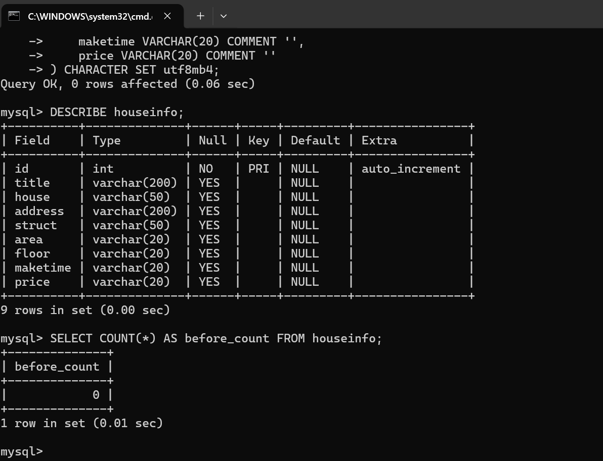

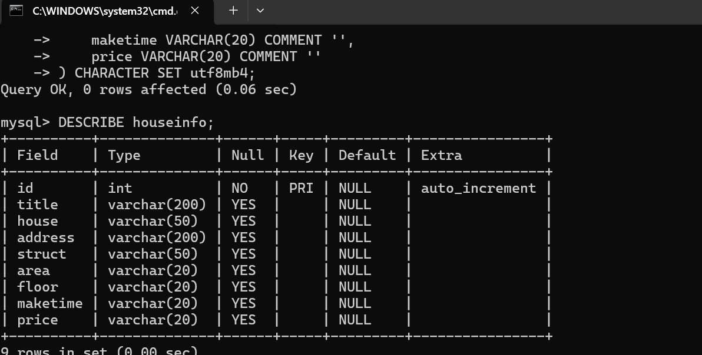

说明：当前使用哪个数据库？`id` 和8个房源字段分别保存什么？

答：当前使用 `smartpark_lab` 库中的 `houseinfo` 表。`id` 是自增主键，数据库为每条房源自动编号；`title` 是房源标题（含卖点描述），`house` 是小区名，`address` 是小区地址，`struct` 是户型（几室几厅几卫），`area` 是建筑面积，`floor` 是楼层信息（所在区间与总层数），`maketime` 是建造年代，`price` 是单价。8 个房源字段均为 varchar 文本类型，与网页上的原始文字保持一致。

## 第二阶段：房源采集与 CSV 数据存储

### 1. 网页分析与房源解析

#### 选择器是怎样得到的

在 Chrome 中按 F12，使用 **Elements → Copy → Copy selector**。选一个字段，记录从完整路径到相对选择器的过程。

- 选择的字段：房源标题（`<h3>`）
- 复制的原始选择器：`#__layout > div > div > div.section > div > div.list > div.property > div.property-content > div.property-content-title > h3`
- 一条房源的父容器选择器：`div.property`
- 最终使用的相对选择器：在父容器内用 `row.select_one("h3")` 取标题；其余字段同理取 `.property-content-info-comm-name`（小区）、`.property-content-info-comm-address`（地址）、`p.property-content-info-text`（户型/面积/楼层/年代等并排的 p 列表）、`.property-price-average`（单价）

**截图：** 框出该字段的 HTML 节点和房源父容器，展示选择器的匹配结果。

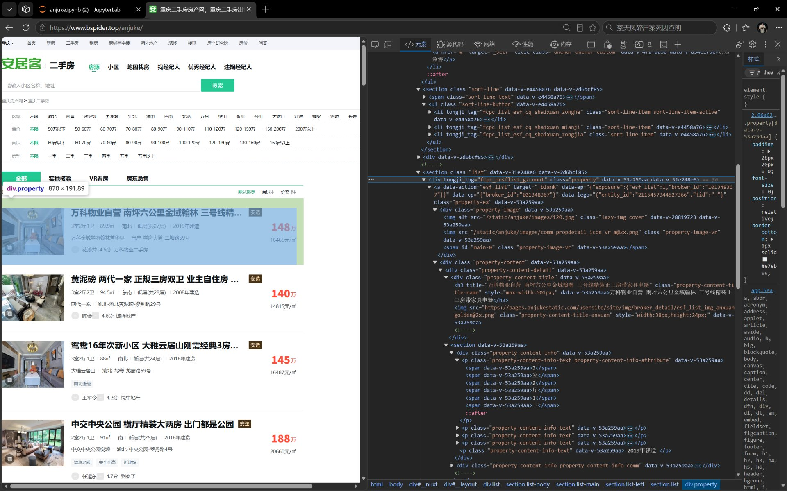

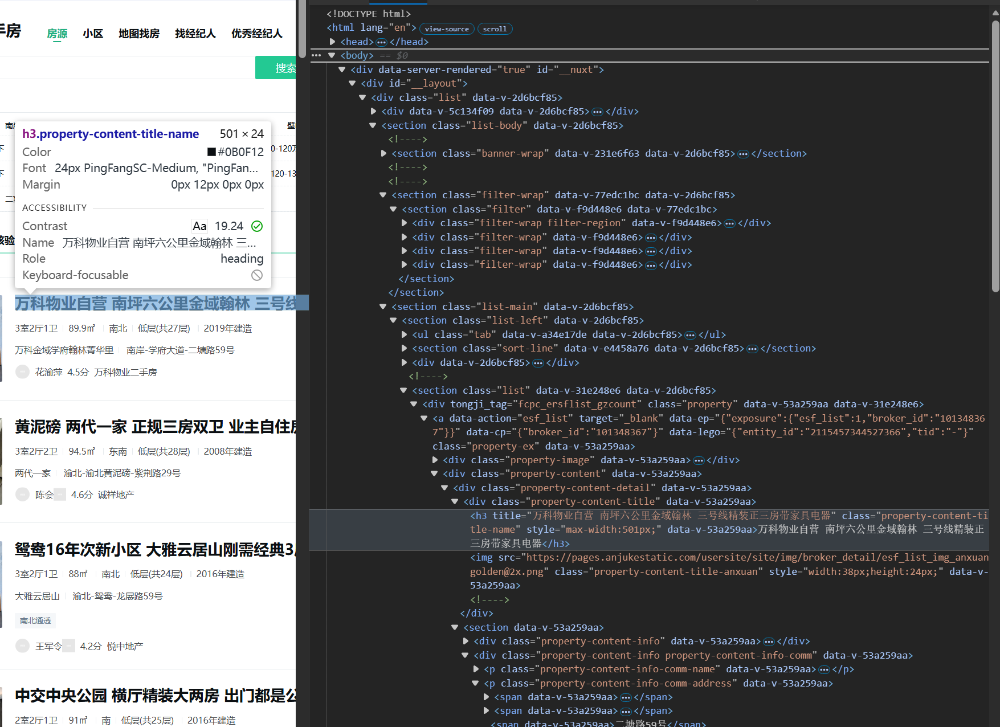

说明：删掉了哪些层级？怎样确认父容器刚好包含一条房源？

答：复制出的完整路径包含 `#__layout`、`div.section`、`div.list` 等页面骨架层级，这些层级对整页只出现一次，对定位单条房源没有意义，全部删掉，只保留每条房源都有的 `div.property` 作为父容器。确认方法：在 Console 里执行 `document.querySelectorAll("div.property").length`，首页返回 60，正好等于页面显示的房源条数；再用 `rows[0]` 打印第一条解析结果，8 个字段都属于同一条房源，说明父容器刚好包住一条房源、不多不少。

#### 解析8个字段

**截图：** 自己编写的解析代码和首条房源的8个字段输出。代码中必须框出：

- `select()` 和 `select_one()`。
- 面积、单价的定位与取值。
- 建造年代的提取和缺失处理。

可分成几张局部截图。另附面积、单价对应的 HTML 节点或网页原文。

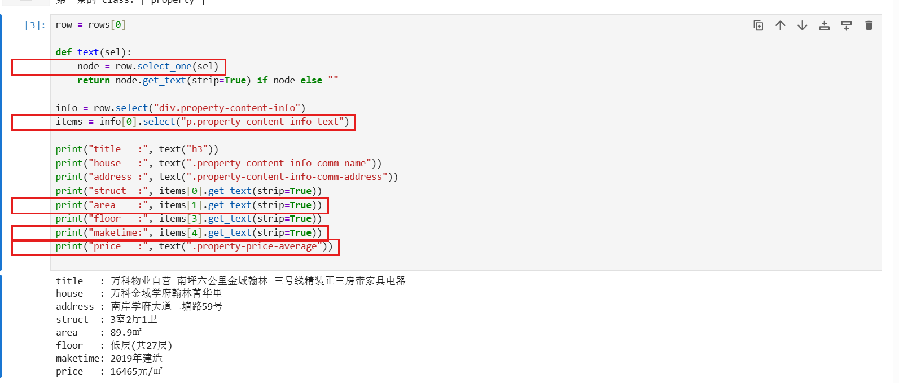

说明：两个选择方法各用在哪里？怎样确认面积和单价没有取错？

答：`select_one()` 用于"整个父容器里只有一个"的节点，如标题 h3、小区名、地址、单价；`select()` 用于"同级重复出现"的节点，如 `p.property-content-info-text` 在一条房源里并排出现多个（户型、面积、朝向、楼层、年代……），取回列表后按下标 `[0]`（户型）、`[1]`（面积）、`[3]`（楼层）、`[4]`（年代）取值。确认方法：把解析出的面积"89.9㎡"、单价"16465元/㎡"与网页上第一条房源显示的数字逐字对照一致；同时用 `if len(items) > n else ""` 做下标越界保护，节点缺失或顺序改变时返回空字符串而不是报错。

### 2. 下一页采集

- 下一页 `href` 原值：`/anjuke/?page=2`（相对路径）
- 用 `urljoin()` 补全后的地址：`http://www.bspider.top/anjuke/?page=2`
- 实际停止原因：正常停止。末页（第 10 页）的"下一页"按钮变为禁用状态、不再提供链接，程序找不到下一页 `href`，按停止条件正常结束，共采集 10 页。

**截图：** 框出提取 `href`、补全地址、循环更新地址和停止条件的代码。附前两页的运行日志，以及最终停止提示。

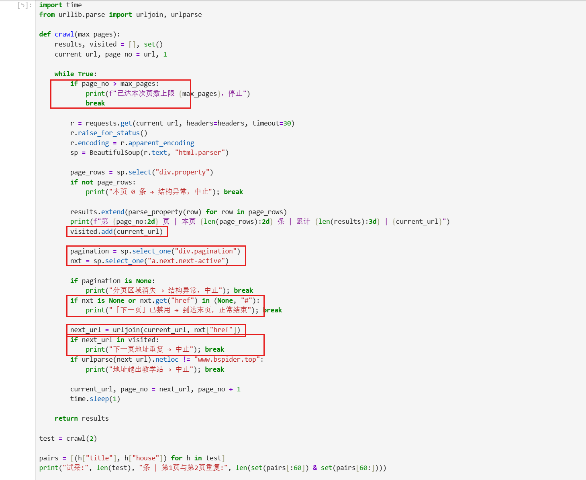

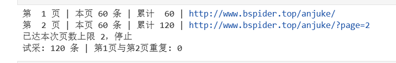

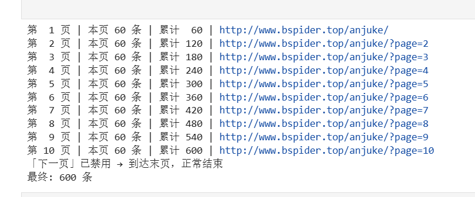

说明：怎样进入下一页？怎样防止重复采集或无限循环？

答：每页解析完后，用 `sp.select_one("a.next.next-active")` 定位分页区里可用的"下一页"链接（class 同时含 `next` 和 `next-active` 才是可点击的下一页按钮），取它的 `href`（相对路径），用 `urljoin(current_url, href)` 拼成完整地址，作为下一轮 `requests.get` 的目标。防重复/防死循环有四道保险：一是分页区或下一页按钮不存在、`href` 为空或 `#`（末页禁用）时正常停止；二是把已访问 URL 存入 `visited` 集合，下一页地址重复即中止；三是用 `urlparse` 校验 `netloc` 必须是 `www.bspider.top`，地址跳出教学站就中止；四是 `max_pages` 页数上限兜底，且每次请求 `sleep(1)`。实际运行在第 10 页后因末页按钮禁用自然停止，共 10 页、累计 600 条。

### 3. 保存 CSV

**截图：** CSV保存与回读代码、回读条数。框出编码、表头和数据写入部分。

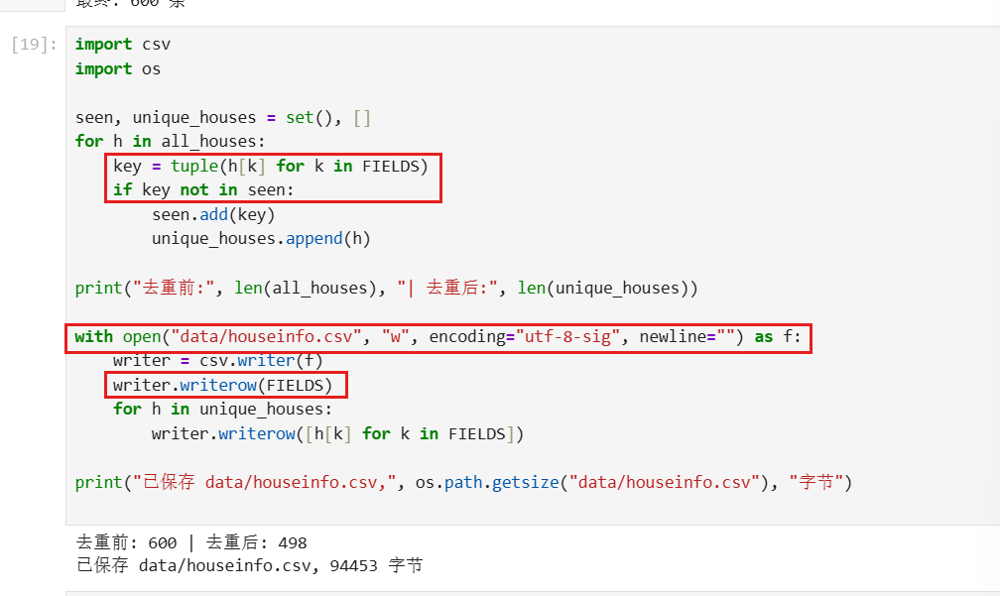

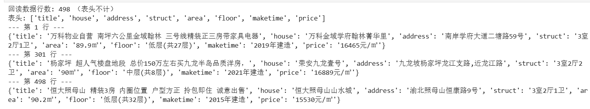

说明：8个字段的顺序是什么？按8个字段完全相同去重后，保存了多少条记录？

答：字段顺序为 title、house、address、struct、area、floor、maketime、price，与数据库表的字段顺序一致。去重前共 600 条（10 页 × 60 条），按 8 个字段完全相同的标准去重后保存 498 条。重复的 102 条主要出现在第 8、9 页之间（两页交叉重复 53 条），是教学站点故意制造的跨页重复。CSV 用 `utf-8-sig` 编码保存，保证 Excel 打开不乱码；回读用 `csv.DictReader` 验证为 498 行（不含表头）。

## 第三阶段：MySQL 数据存储

### 1. 读取 CSV 并入库

本阶段读取第二阶段的 `data/houseinfo.csv`，不重新采集。

**截图：** 框出读取CSV、按8个字段整理入库参数的代码。

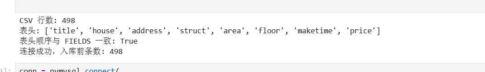

**截图：** 自己编写的入库代码。框出 `executemany()`、`commit()`、`rollback()`，以及关闭游标和连接的操作。另框出避免重复插入的代码。

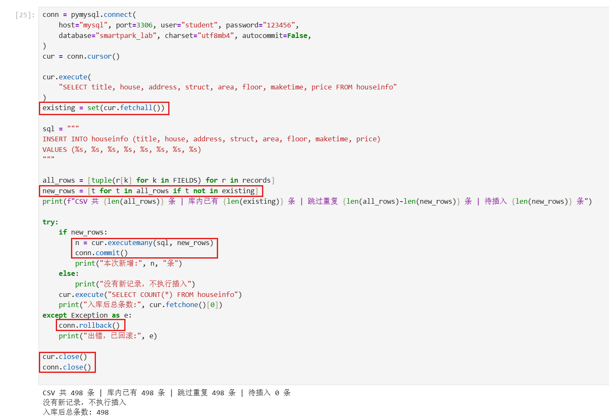

说明：每条记录怎样对应8个参数？成功、失败时分别做什么？再次运行时怎样避免重复插入？

答：INSERT 语句写明 8 个字段名和 8 个 `%s` 占位符，每条 CSV 记录按 FIELDS 固定顺序转成 8 元素的元组，元组位置与字段顺序一一对应，通过 `executemany(sql, records)` 参数化传入，不用字符串拼接。成功时调用 `conn.commit()` 提交事务，数据对其他连接可见；任何异常进入 except 分支调用 `conn.rollback()` 回滚，撤销本次未提交的写入，最后无论成败都先 `cur.close()` 再 `conn.close()` 释放资源。防重复：入库前先 `SELECT` 全部已有记录的 8 字段放入 set，CSV 记录同样转成 8 元组，只把 `t not in existing` 的新记录交给 executemany，8 个字段完全相同即视为重复跳过；自增长 id 不能用来判重。

### 2. 核对结果

#### 查询条数和样本

**截图：** MySQL 终端中的入库前后 `SELECT COUNT(*)`、重跑后的条数，以及 `SELECT ... LIMIT 5` 的结果。

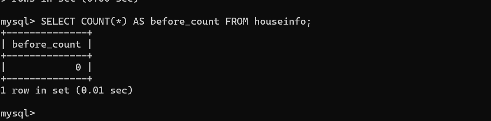

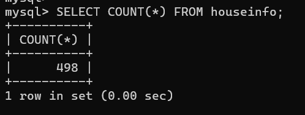

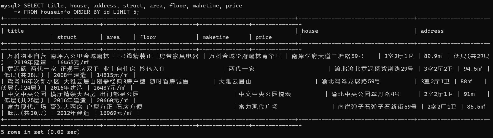

| 项目 | 实际结果 |
|---|---|
| 成功采集页数 | 10 页 |
| 采集记录数（去重前） | 600 |
| 完全相同的重复记录数 | 102（其中第 8、9 页交叉重复 53 条） |
| CSV数据行数（不含表头） | 498 |
| 入库前条数 | 0（试插前）；试插 5 条后为 5 |
| 入库后条数 / 本次新增条数 | 498 / 新增 493（跳过试插过的 5 条） |
| 关闭上次程序后，同批数据独立重跑的条数 / 新增条数 | 498 / 新增 0（提示"没有新记录，不执行插入"） |
| 是否采集完整；未完成的原因 | 完整。10 页全部采集，600→498 的差额是站点故意制造的跨页重复，按"8 字段完全相同"去重属正常处理 |

说明：首次入库后的条数应等于去重后的CSV数据行数，8个字段的内容也应一致。若不一致，说明原因。总条数以实际结果为准。

答：一致。入库后 COUNT(*) = 498，等于去重后 CSV 数据行数 498；第 12 格逐字段比对三个样本均输出"该样本全部一致"，重跑一次新增 0 条，证明防重复逻辑有效。

#### 逐条核对

选取第一条、跨页一条和最后一条，比较网页、CSV与数据库中的8个字段。快照实验对照教师提供的网页文件。

**截图：** 三条样本的对照结果，框出面积、单价和年代。可分图。

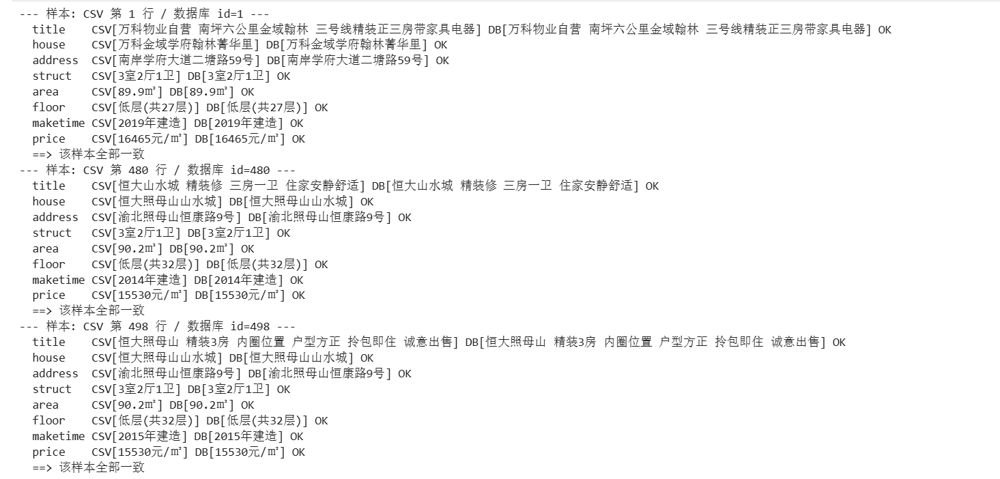

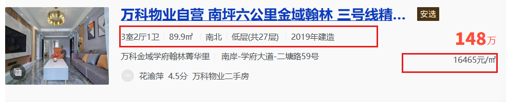

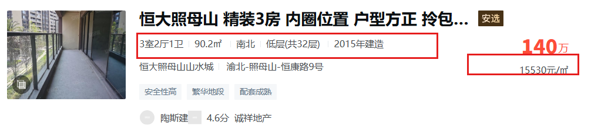

- 样本1（页码或URL、记录位置）：第 1 页 http://www.bspider.top/anjuke/ 第 1 条 —— "万科物业自营 南坪六公里金域翰林…"，89.9㎡、低层(共27层)、2019年建造、16465元/㎡，网页/CSV/数据库三方一致
- 样本2（页码或URL、记录位置）：第 8/9 页交界，CSV 第 480 行 / 数据库 id=480 —— "恒大山水城 精装修 三房一卫 住家安静舒适"，90.2㎡、低层(共32层)、2014年建造、15530元/㎡，CSV 与数据库一致
- 样本3（页码或URL、记录位置）：第 10 页 http://www.bspider.top/anjuke/?page=10 最后一条 —— "恒大照母山 精装3房 内圈位置 户型方正 拎包即住 诚意出售"，90.2㎡、低层(共32层)、2015年建造、15530元/㎡，网页/CSV/数据库三方一致

核对结论及差异：三个样本 8 个字段在三方完全一致，无差异。

## 问题与解决

- 遇到的问题、处理方法及结果：
  1. 最初 User-Agent 只写 "Mozilla/5.0"，请求被教学站识别为异常流量，返回验证页且解析不到房源；改为完整的 Chrome 浏览器 UA 后正常返回 200。
  2. 翻页时最初用 `a.next` 定位"下一页"，从第 2 页起"上一页"按钮也带 `next` class 且排在前面，被误当成"下一页"，导致重复采集；观察分页区 HTML 后改为 `a.next.next-active`——只有可点击的"下一页"才带 `next-active` class——问题解决。
  3. 采集 600 条后发现比预期少——实际是站点在第 8、9 页故意放置跨页重复房源，按 8 字段完全相同去重后 498 条，属正常现象而非程序错误。
  4. mysql-console 终端里查询中文显示为 "？"，原因是终端客户端默认 latin1 字符集；在 mysql> 中执行 `SET NAMES utf8mb4;` 后重新查询显示正常（数据本身无乱码，用 Python 以 utf8mb4 连接查询可交叉验证）。
  5. 试插格在数据入库后被误重跑了一次，又插入 5 条与已有记录完全相同的数据（总数一度变为 503）——这恰好实证了"自增长 id 不能防止房源重复"。处理：在 MySQL 终端按 8 个字段自连接分组、保留每组最小 id，删除 5 条冗余记录，COUNT 恢复 498；此后重跑带防重复逻辑的全量入库格，稳定显示"跳过 498 / 待插入 0 / 总条数 498"。
- 尚未解决的问题、未完成的步骤：无

## 思考题

1. 本次怎样实现下一页采集？结合自己的代码说明。

   答：在 `crawl()` 的每轮循环里，解析完当前页并收集房源后，用 `sp.select_one("a.next.next-active")` 找到分页区中可点击的"下一页"节点，取其 `href`（相对路径如 `/anjuke/?page=2`），用 `urljoin(current_url, href)` 补全成完整 URL 赋给 `current_url`，进入下一轮 `requests.get`。当下一页按钮不存在（末页禁用）、`href` 为空或 `#`、地址已在 `visited` 中、域名越界或 `page_no > max_pages` 时退出循环，实现"边采边翻、翻无可翻即停"。

2. 旧代码把 out_list 定义在全局。你把结果列表放在哪里？为什么？

   答：我把 `results` 和 `visited` 都定义在 `crawl()` 函数内部作为局部变量，每次调用 `crawl()` 都从空列表开始。这样可以避免多次运行时旧数据残留在全局列表里造成重复累计，也避免不同函数之间通过全局变量产生隐式耦合；函数通过 `return results` 把结果交给调用方，数据流向更清晰。

3. 你怎样获取建造年代？节点缺失或顺序改变时，怎样处理？

   答：建造年代在 `div.property-content-info` 下 `p.property-content-info-text` 列表的下标 4 处，用 `items[4].get_text(strip=True)` 提取，得到如"2019年建造"的文本并保持原样入库。防缺失/防顺序变化：取值前先判断 `len(items) > 4`，不满足就返回空字符串 `""` 而不是抛 IndexError；这样个别房源节点缺失时程序不中断，该字段以空值入库，后续核对也能通过空字符串定位到问题记录。

## 提交检查

- [x] 实验一原仓库的 `lab02/` 中已有源码、CSV、报告和真实截图。
- [ ] 截图清楚，关键代码已框出，每项附有个人解释。
- [ ] GitHub上能打开文件和图片，未上传个人账号密码、`.env`或教师答案。
- [ ] 未完成项已如实说明；学习通只交原仓库链接。

如使用 AI，简述它帮助了什么，以及自己修改、运行和核对了什么：

答：AI 帮助分析了网页结构、给出了选择器思路和入库程序框架，并协助排查了 UA 被拦截、mysql 终端乱码两个问题。本人完成了全部代码的输入与运行：试采 2 页、全量采集 10 页、去重保存 CSV、连接测试、5 条试插、全量入库 498 条、重跑防重复验证、三条样本逐字段核对，并用 MySQL 终端独立执行 SQL 核对了表结构、条数和样本内容。
