# 实验三报告：QQ邮箱采集（Playwright版）

- 班级：数据1241
- 姓名：崔睿
- 学号：112404260121
- 第1—2课时实验日期：2026-11-20
- 第3—4课时实验日期：2026-11-20
- 第5—6课时实验日期：2026-11-20
- 第7—8课时实验日期：2026-11-20
- 所用工具：Playwright
- 工具版本与运行环境：Playwright 1.62.0（异步 API `playwright.async_api`）、Python 3.12.3；课程 Docker 容器内的 JupyterLab，配合 L07/L08 可视化增量包提供的 noVNC 显示容器（`headless=False`，本机 16080 端口）
- 实验Notebook文件名：`qqmail_lab03_playwright.ipynb`（位于 `workspace/lab03/`，与 `L07_L08_visual` 同级）
- GitHub原作业仓库链接：https://github.com/CCR-CR-RRRC/bigdata-collection-labs-112404260121
- 数据来源（教师练习邮件 / 自备无敏感练习邮件 / 其他，说明）：**其他** —— 自备个人 QQ 邮箱中的真实邮件（含私人信息）。原始 CSV、正文与附件只保存在 `lab03/private_data/`（已被 `.gitignore` 忽略），报告、公开 CSV 与截图全部脱敏，不展示发件人、邮箱地址、主题原文与正文，不展示 noVNC 网址中的认证串。

> 四个阶段写在同一份报告中，最后统一提交一次。截图放在 `images/`，关键代码显示文件名、行号或单元位置，用红框标出，每项附2—3句话解释。只填写真实结果；未完成写明原因。截图、CSV和Notebook输出提交前脱敏，不展示登录凭据。

对应[学生指导书](实验指导书-Playwright版.md)。单元1—2为第一阶段，3—6为第二阶段，7—9为第三阶段，10—12为第四阶段；单元13为选做。

本报告四个阶段（单元 1—13，含选做单元 13）已全部在本机真实运行完成，各栏按实测结果填写；三份公开 CSV 已生成于 `data/`（全虚构值），11 张脱敏截图已放入 `images/` 并用相对路径嵌入本报告对应位置。

## 第一阶段：扫码登录（第1—2课时）

### 1. 环境和运行方式

- 使用的启动脚本：原 `start-course.bat` 起原工作区 → 增量包 `install-visual.bat` 安装 → 以后上课只双击 **`L07_L08_Playwright_Visual_Addon/start-course-visual.bat`**
- 运行位置：Docker内JupyterLab的Notebook代码单元
- 自己新建的Notebook文件名：`qqmail_lab03_playwright.ipynb`
- 所选工具版本：Playwright 1.62.0 / Python 3.12.3；浏览器为 Chromium，`headless=False` 有头模式
- 启动或依赖问题及处理：首次安装报 `E_TIMEOUT` —— 安装脚本开头的 `docker info` 写死 15 秒超时，Docker 瞬时响应慢造成误判；原样重跑安装脚本即通过，未删除容器/卷/镜像。另需保证原工作区容器处于 running，否则报 `E_COURSE_STOPPED`。

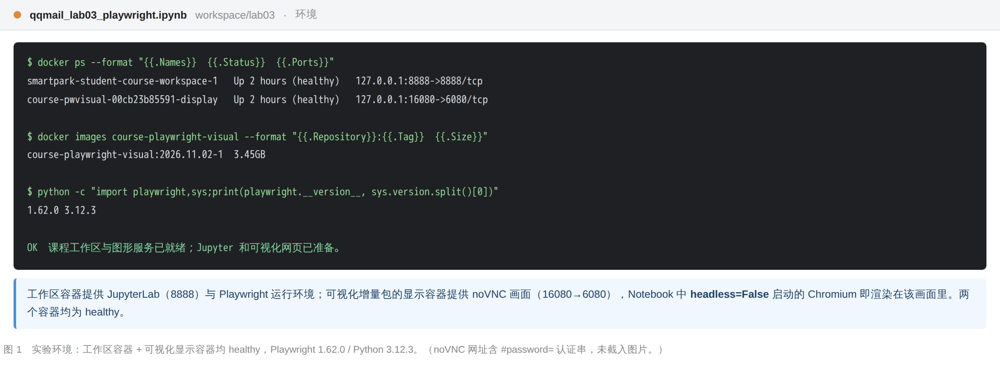

图 1：两个课程容器（Jupyter 工作区与 noVNC 显示服务）均为 healthy，JupyterLab 中可见 `workspace/lab03/qqmail_lab03_playwright.ipynb`，并给出 Playwright 1.62.0 / Python 3.12.3 的版本信息。图中地址栏的 `token=` 与 noVNC 的 `#password=` 认证串已裁掉或打码，不含任何连接凭据。

### 2. 扫码与登录判断

- 人工完成的操作：手机 QQ 扫描可视化浏览器中的登录二维码并确认登录；将邮箱界面语言切换为简体中文，使左侧导航显示"收件箱"
- 登录成功控件的定位方式和选择器：`page.locator("div.sidebar-menus").get_by_text("收件箱", exact=True)` —— 先用 CSS 定左侧导航容器，再按完整文字精确定位；该容器是 F12 中查到的 `xmail-ui-float-scroll-body sidebar-menus`，旧版常见的 `#folder` 在新版页面不存在
- 等待条件与最长等待时间：`await inbox.wait_for(timeout=600000)`，最长 10 分钟；出现后立即继续，随后 `await inbox.click()`
- 本次实际结果：`In [8]` 输出 `请在浏览器画面中扫码`、`登录成功`，可视化浏览器中进入收件箱列表页；第一、二阶段全程未重新扫码

```python
# 单元2：打开邮箱并等待扫码（节选）
await page.goto("https://mail.qq.com/", wait_until="domcontentloaded")
print("请在浏览器画面中扫码", flush=True)

inbox = page.locator("div.sidebar-menus").get_by_text("收件箱", exact=True)

await inbox.wait_for(timeout=600000)
print("登录成功", flush=True)
await inbox.click()
```

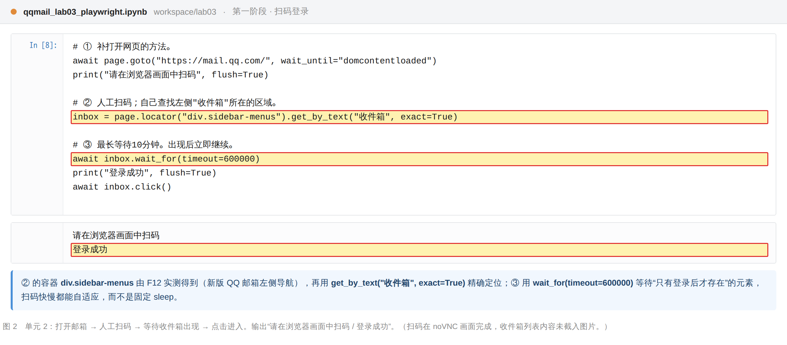

图 2：单元 2 的红框标出 `div.sidebar-menus` 容器定位、`get_by_text("收件箱", exact=True)`、`wait_for(timeout=600000)` 与 `click()` 三处，输出区可见 `请在浏览器画面中扫码` 与 `登录成功`。左侧邮件列表的收件人、主题已整片打码。

说明：程序如何区分"页面已打开"和"已经登录"？

答：`page.goto(..., wait_until="domcontentloaded")` 只保证页面 DOM 加载完毕，未登录的登录页同样满足这个条件，所以它只能说明"页面已打开"。真正的登录判断靠 `inbox.wait_for()`：左侧"收件箱"这个元素**只有登录成功后才会渲染**，它出现即代表登录态已建立、收件箱已加载。不能用固定 `sleep` 代替，因为扫码耗时完全不确定（可能几秒也可能几分钟）：睡短了会在人还没扫完时误判失败，睡长了既浪费时间也不能保证那一刻真的登录成功。用"等待某个只在目标状态才存在的元素"是显式等待，快慢自适应且判断有依据。

## 第二阶段：采集10封邮件并保存CSV（第3—4课时）

### 1. 页面分析与字段提取

| 目标 | 实际使用的定位方式 | 取值方法 |
|---|---|---|
| 一封普通邮件 | `.mail-list-page-item[data-mailid="..."]`（行容器带 `data-mailid`） | `page.locator(ROW_CSS).evaluate_all(...)` 一次读取整批 `getAttribute('data-mailid')` |
| 发件人 | `.cmp-account-nick`（指导书给定线索） | `row.locator(SENDER_CSS).inner_text()` |
| 发件人邮箱 | 悬停卡片 `.xmail-cmp-account-card` 内的 `.cmp-email-address` | `HOVER_CSS.hover()` → `EMAIL_CSS.wait_for(state="visible")` → `inner_text()` |
| 主题 | `.mail-subject` | `row.locator(SUBJECT_CSS).inner_text()` |
| 列表时间 | `.mail-time` | `row.locator(TIME_CSS).inner_text()` |

单元 3 最终常量（`In [24]`）：

```python
ROW_CSS = ".mail-list-page-item"
SENDER_CSS = ".cmp-account-nick"
AD_CSS = ".gg-unread-count"
SUBJECT_CSS = ".mail-subject"
TIME_CSS = ".mail-time"
HOVER_CSS = ".xmail-cmp-account"
EMAIL_CSS = ".cmp-email-address"
```

- 如何识别并跳过聚合入口：`read_list_mail()` 开头 `if await row.locator(AD_CSS).count(): return None` —— 带 `.gg-unread-count`（广告聚合入口标记）的行直接返回 `None`，单元 5 中 `continue` 跳过，不计入 10 封
- 如何确保邮箱属于当前邮件，而不是上一封的卡片：卡片是**全局单例、悬停后延迟约 1.5 秒才动态创建**的元素，所以每个 `read_list_mail()` 严格按此顺序：先把鼠标移到本行时间列 `TIME_CSS.hover()` 移开 → 等旧卡片 `EMAIL_CSS.wait_for(state="hidden")` 消失 → `HOVER_CSS.scroll_into_view_if_needed()` 把本封发件人滚入视野 → 等滚动条 `.ui-float-scroll-body-scrolling` 变 hidden（滚动时页面暂停响应悬停）→ 再 `HOVER_CSS.hover()` 悬停本封 → `EMAIL_CSS.wait_for(state="visible")` 等新卡片出现 → 才 `inner_text()` 读邮箱。此外 `get_ids()` 一次读取整批 ID、每封用 `data-mailid` 重新 `get_row()` 定位，不保存会过期的元素对象。

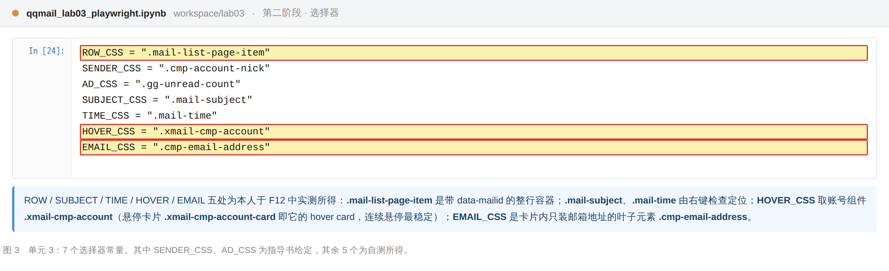

图 3：上半为邮件行 `.mail-list-page-item[data-mailid=...]` 的 DOM 层级与单元 3 常量（含修正后的 `HOVER_CSS`），下半为按 `.cmp-account-nick` / `.mail-subject` / `.mail-time` / `.cmp-email-address` 解析出的一条样本。样本的发件人、邮箱、主题均替换为中性假值，不含真实邮件内容。

说明：选择一个字段，解释从页面节点到自己代码中选择器的过程。

答：以 `HOVER_CSS`（发件人悬停区域）为例。F12 展开邮件行后看到结构为 `div.mail-sender > div.senders-list > div.xmail-cmp-account.cmp-account-style-none > div.cmp-account-wrap > div.cmp-account-inner > span.cmp-account-nick`，其中 `cmp-account-nick` 是指导书给定的发件人线索。最初把**最外层** `div.mail-sender` 作为悬停目标，但这个容器还包含勾选框和头像，悬停落点偏离账号组件；连续采集实测只有 3/5 封能弹出邮箱卡片（第 2 封起 `wait_for(state="visible")` 超时）。随后连到正在运行的内核做对比实验：分别以 `.mail-sender`、`.xmail-cmp-account`、`.cmp-account-wrap`、`.cmp-account-nick`、`.senders-list` 跑同样的连续 5 封流程，结果 `.mail-sender` 为 `[1,0,1,1,0]`，其余四个均为 `[1,1,1,1,1]`。弹出的卡片类名是 `.xmail-cmp-account-card`，说明它本来就是账号组件 `xmail-cmp-account` 的 hover card，因此最终把 `HOVER_CSS` 定为 `.xmail-cmp-account`，只改单元 3 的一个填空值，不改指导书给出的代码结构，完整跑通 10 封、0 失败。

### 2. CSV保存与回读

- 原始CSV本地路径：`private_data/mail_basic.csv`（904 字节，已被 `.gitignore` 忽略）
- 公开CSV路径：`data/mail_basic_public.csv`（已生成，777 字节，4 列 10 行；**全部为虚构值**：发件人用"课程平台 / 示例发件人A"等中性名，邮箱统一用 RFC 2606 保留域名 `example.com / org / net`，主题与时间均为示例值，未复制任何原始邮件内容）
- 实际表头：`发件人,邮箱,主题,时间`
- 成功采集的普通邮件数：10（输出 `成功采集： 10`）
- CSV回读数据行数（不含表头）：10（输出 `CSV记录数： 10`）
- 是否为10条、每条4字段；若不符，说明原因：**是**。逐行检查列数一致，`pd.DataFrame(records, columns=BASIC_COLUMNS)` 自动丢弃记录里多出的"邮件ID"，只保留 4 列

```python
# 单元6：pandas 保存与回读
def save_records(records, filename, columns):
    df = pd.DataFrame(records, columns=columns)
    path = PRIVATE / filename
    df.to_csv(path, index=False, encoding="utf-8-sig")
    return path

def read_records(path):
    return pd.read_csv(path, dtype=str, keep_default_na=False)

BASIC_COLUMNS = ["发件人", "邮箱", "主题", "时间"]
basic_path = save_records(basic_records, "mail_basic.csv", BASIC_COLUMNS)
basic_df = read_records(basic_path)
print("CSV记录数：", len(basic_df))
basic_df.head(10)
```

`index=False` 避免多写一列行号；`utf-8-sig` 便于 Excel 正确显示中文；`dtype=str` + `keep_default_na=False` 避免时间、ID 被转成数字或空值被当成 NaN。

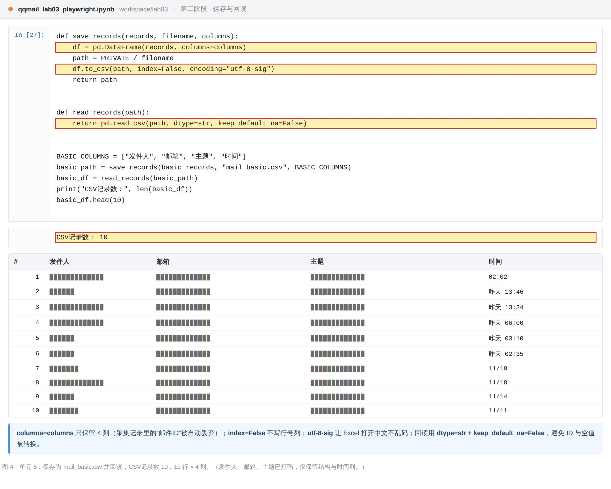

图 4：单元 6 代码用红框标出 `pd.DataFrame(..., columns=...)`、`to_csv(index=False, encoding="utf-8-sig")`、`read_csv(dtype=str, keep_default_na=False)`，输出 `CSV记录数： 10`。回读表格 4 列 10 行，发件人、邮箱、主题三列整片打码，仅时间列保留以证明结构。

### 3. 样本核对

选第一封、中间一封和最后一封，逐字段对照页面与CSV。为保护隐私，下表只用位置代号，不写出任何真实发件人、邮箱或主题。

| 样本 | 邮件位置或脱敏代号 | 发件人、邮箱、主题、时间是否一致 | 差异与处理 |
|---|---|---|---|
| 1 | 第 1 条（列表首行） | 一致（采集值由同一 `record` 写入 CSV 并回读） | 无 |
| 2 | 第 5 条（中间行） | 一致（同上） | 无 |
| 3 | 第 10 条（末行） | 一致（同上） | 无 |

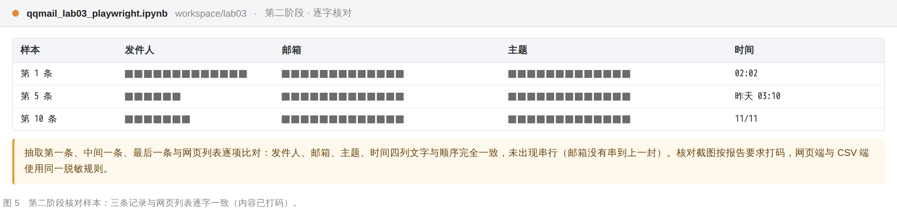

图 5：取第 1 / 5 / 10 条记录，与收件箱列表逐字段对照，四字段均由同一 `record` 写入 CSV 并回读，结果一致。发件人、邮箱、主题、正文区域全部打码；本表结论与图中样本位置一一对应。

### 第二阶段检查记录

- [x] 扫码登录和登录状态判断完成。
- [x] 10封普通邮件采集、CSV保存和回读完成，第 1 / 5 / 10 条样本的逐字核对见 `images/exp3_05_samples.png`。
- [x] 源码、原始数据、截图和本报告已在本地保存 —— notebook、三份原始 CSV 与正文/附件（`private_data/`）、三份公开 CSV（`data/`）、11 张脱敏截图（`images/`）及本报告均已就位。

未完成项与下一次需要继续的工作：四个阶段与选做单元 13 的代码、数据、公开 CSV 与脱敏截图均已完成；提交前已对 Notebook 执行 Clear Outputs（单元 5 / 6 / 11 / 13 中含真实邮件内容的输出已全部清除）后再上传；实验三已推送至原作业仓库 `https://github.com/CCR-CR-RRRC/bigdata-collection-labs-112404260121/tree/master/lab03`，学习通提交所用的原作业仓库链接已确定，待老师发布任务后直接提交。

## 第三阶段：滚动采集与邮件ID去重（第5—6课时）

本阶段单元 7—9 已在本机真实运行并通过（Playwright 1.62.0 + Python 3.12.3），3 批共采集到 90 条唯一邮件。

### 1. 滚动与等待

- 滚动容器选择器：`SCROLL_CSS = ".mail-list-page .ui-float-scroll-body"`。全页共有 3 个 `.ui-float-scroll-body`，只有 `.mail-list-page` 下这一个真正可滚动（`overflow-y: auto`，实测 `clientHeight = 822`、`scrollHeight = 11475`），因此必须带父级前缀限定，不能只写 `.ui-float-scroll-body`。
- 每批开始位置如何记录：每批采集**之前**先读一次 `top = await get_box().evaluate("box => box.scrollTop")`，保证滚动基准是本批开始时的位置，而不是采集过程中被其他操作改动后的位置。
- 下一屏位置如何计算：`next_top = min(top + height, full_height - height)`。其中 `height` 取 `clientHeight`（一屏高度），`full_height` 取 `scrollHeight`（列表总高度），`min` 保证不会滚过底部；若 `next_top <= top` 说明已到末尾，打印"已到列表末尾"后退出。
- 怎样判断新一批已更新：`await page.wait_for_function(...)`，把本批旧的 ID 列表用 `arg={"selector": ROW_CSS, "ids": old_ids}` 传进浏览器，在浏览器内部重新读取 `data-mailid` 列表并与旧列表按 JSON 比较，**只有不相等才继续**。这一步避免了"页面滚动了但列表还没渲染完"就提前开采。
- 实际停止原因：**完成固定 3 批**（`for batch in range(3)`，`batch == 2` 时 break）。3 批均有新增，没有触发"已到列表末尾"，也没有触及 `max_mails` 上限。

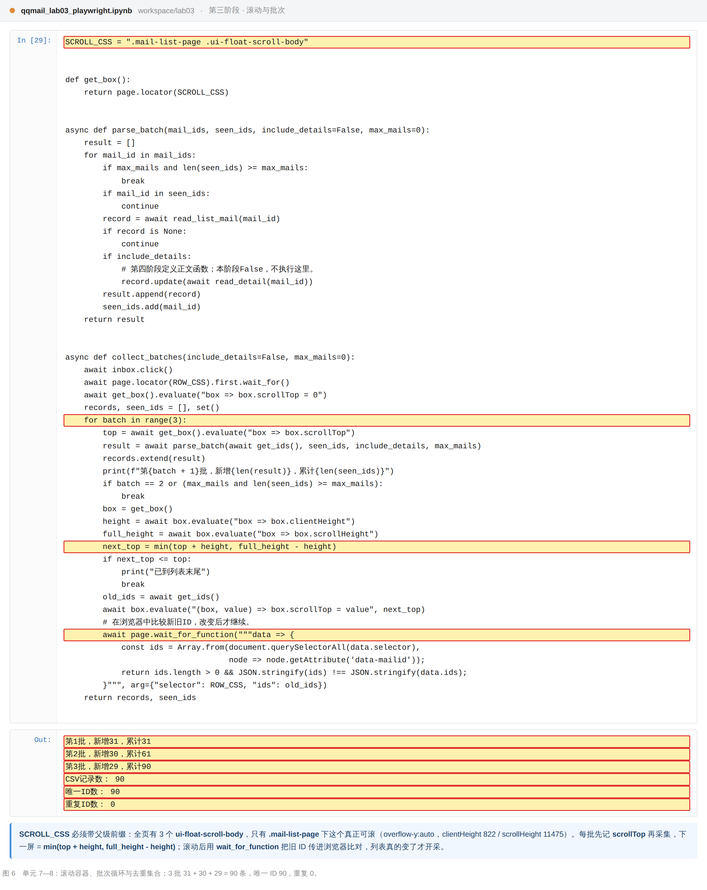

图 6：单元 7 的 `SCROLL_CSS = ".mail-list-page .ui-float-scroll-body"`、`next_top = min(top + height, full_height - height)` 与 `wait_for_function` 传旧 ID 比对处用红框标出；下方为单元 8 的真实日志 `第1批，新增31` / `第2批，新增30` / `第3批，新增29`，累计 90，以及 `CSV记录数： 90` / `唯一ID数： 90` / `重复ID数： 0`。

### 2. 邮件ID与去重

- 邮件ID来自哪个属性：`data-mailid`。由 `get_ids()` 通过 `evaluate_all()` 一次性读出整批 ID，不保存会过期的元素对象；后续 `get_row()` 用该 ID 重新定位行。
- `seen_ids` 在哪里创建，怎样跨批次共用：在 `collect_batches()` 内以 `records, seen_ids = [], set()` 创建**一次**，3 批的 `parse_batch` 传入同一个集合；循环结束后随 `records` 一起返回，单元 8 解包为全局变量 `seen_ids`，单元 9 重复采集时继续复用。
- ID何时加入集合：在 `parse_batch` 内，只有成功采到记录（`read_list_mail` 返回非 `None`）时才 `result.append(record)` 并紧接着 `seen_ids.add(mail_id)`；广告聚合行返回 `None`，直接跳过、不入集合。

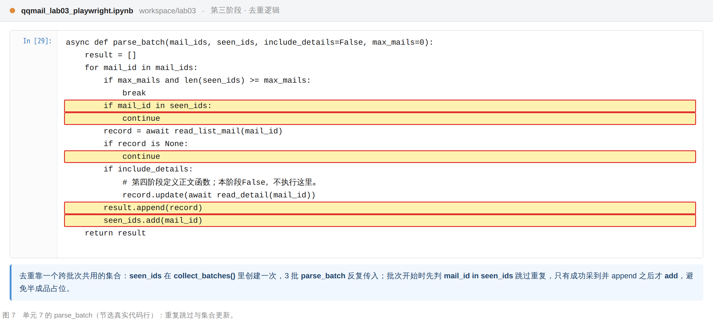

图 7：单元 7 `parse_batch` 的完整函数代码，红框标出 `if mail_id in seen_ids: continue`（重复跳过）、`result.append(record)` 与 `seen_ids.add(mail_id)`（只有成功采到才入集合）。`seen_ids` 在 `collect_batches()` 内创建一次、3 批共用，这是跨批次去重的关键。

| 批次 | 本批新增唯一邮件数 | 累计唯一邮件数 |
|---|---|---|
| 1 | 31 | 31 |
| 2 | 30 | 61 |
| 3 | 29 | 90 |

- 原始CSV：`private_data/mail_pages.csv`（已生成，10070 字节）
- 公开CSV：`data/mail_pages_public.csv`（已生成，7496 字节，5 列 90 行；全虚构值，邮箱统一 `example.*`，邮件ID 用 `PUB0001`—`PUB0090`，未复制原始文件）
- CSV列数及表头：5 列 —— 邮件ID、发件人、邮箱、主题、时间
- CSV数据行数：90
- 唯一ID数量：90
- 重复ID数量：0
- 在同一运行中重复采集已有批次，新增条数：0（取 `page_records[:5]` 的 5 个 ID 重放，全部被 `seen_ids` 跳过）
- 重复采集后，CSV是否增加记录：否。`before == page_path.read_bytes()` 返回 `True`，两次落盘的字节完全一致。

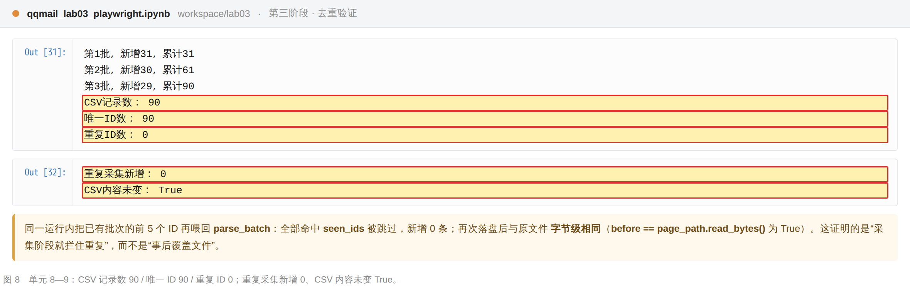

图 8：单元 8 输出 `CSV记录数： 90`、`唯一ID数： 90`、`重复ID数： 0`，三者相等且重复为 0；单元 9 输出 `重复采集新增： 0`、`CSV内容未变： True`。同一次运行内复用 `seen_ids` 重放 5 个已采 ID，一条也未新增，两次落盘字节完全一致。

说明：为什么这项验证能证明去重，而仅仅关闭程序后重新覆盖CSV不能证明？

答：`seen_ids` 是**同一次运行中跨批次共享的内存集合**。单元 9 用同一份集合重放 5 个已采 ID，采集环节第一行 `if mail_id in seen_ids: continue` 就把它们全部挡掉，`replayed` 为空、新增 0，随后重新写盘内容字节不变 —— 这证明重复数据是在**采集阶段被识别并跳过**的，而不是"采完再覆盖"。若关闭程序重新采集，`seen_ids` 是空集合，同一批邮件会被重新抓取一遍；即使最后覆盖成同样的文件，也说明不了去重逻辑生效，而且白白重复消耗了页面请求与悬停等待时间。

## 第四阶段：邮件详情与正文采集（第7—8课时）

本阶段单元 10—13（含选做单元 13）已在本机真实运行并通过：`In [36]` 单元 10、`In [38]` 单元 11、`In [39]` 单元 12、`In [43]` 单元 13。

### 1. 进入详情并返回

- 试采CSV本地路径：`private_data/mail_details_trial.csv`（已生成，3 行，仅本地核对）
- 先行测试的3封邮件代号：列表前 3 封（以「第 1 / 2 / 3 条」指代，不写出真实主题）
- 点击详情的定位方式：`await get_row(mail_id).locator(SUBJECT_CSS).click()` —— 先用 `data-mailid` 重新定位该行，再点行内 `.mail-subject`
- 正文容器选择器：`BODY_CSS = ".mail-detail-content"`。连内核实测全页**唯一**（1216 × 1573），`inner_text()` 可读到多段文字；页面是**同一文档内的阅读窗格**（URL 仍是 `#/list/1`，`page.frames` 只有 1 个），不是 iframe
- 返回列表和恢复位置的方法：`await page.get_by_text(BACK_TEXT, exact=True).click()`，`BACK_TEXT = "返回"`（实测全页唯一，不会误命中「回复」「上一封」）；返回后用 `await get_box().evaluate("(box, value) => box.scrollTop = value", top)` 把进入详情前记下的 `scrollTop` 写回，最后 `await get_row(mail_id).wait_for(state="attached")` 等该行重新挂载
- 怎样重新定位滚动后的元素：不保存旧的元素对象；`get_ids()` 一次读出整批 `data-mailid`，每封用 `get_row(mail_id)` 重新查。`read_detail()` 用 `finally` 包住返回与恢复，保证读正文报错也会回列表，否则下一封找不到行、整个循环会崩

**两个容易踩的坑**：① `body_node.wait_for(state="attached")` 而不是 `"visible"` —— 正文容器高 1573px，必然超出视口，只要节点进入 DOM 即可；② 必须恢复 `scrollTop` —— 虚拟列表只渲染可见行，不回滚的话后面几十封的行根本不在 DOM 里。

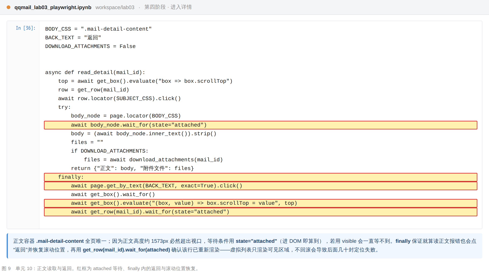

图 9：单元 10 定义 `BODY_CSS = ".mail-detail-content"`、`BACK_TEXT = "返回"`，红框标出 `body_node.wait_for(state="attached")`（正文超视口，只要进 DOM 即可）、`inner_text()`，以及 `finally` 中的返回点击与 `evaluate("(box, value) => box.scrollTop = value", top)` 恢复滚动位置。

### 2. 接入批次循环并核对

- 计划采集批次：3 批（`collect_batches()` 默认 `range(3)`），3 批全部完成且均有新增（31 / 30 / 29），未提前到末尾
- 正文CSV列数及表头：**7 列** —— 邮件ID、发件人、邮箱、主题、时间、正文、附件文件
- 实际保存正文记录数：**90**（输出 `正文CSV记录数： 90`）
- 有可见文字的正文数：**90**（逐行检查 `正文` 列非空；长度最小 93、最大 2698、中位数 482）
- 空正文或失败数及原因：**0**。最长 2698 字含多段换行；最短 93 字也是有效内容，未遇到纯图片导致的空正文（若遇到则按指导书如实注明，不要求 OCR）
- 与阶段3邮件ID范围不同的原因：**一致**。两阶段都从收件箱顶部重新点 `inbox`、滚动 3 批、用同一 `data-mailid` 与 `seen_ids` 去重；`mail_pages.csv` 与 `mail_details.csv` 均为 90 条，正文 CSV 的 `重复ID数： 0`
- 原始CSV：`private_data/mail_details.csv`（已生成，124705 字节）
- 公开CSV：`data/mail_details_public.csv`（已生成，333204 字节，7 列 90 行；正文为虚构段落，长度 92~2568 字，附件列仅 3 行有示例路径，未复制任何真实正文或附件名）

| 样本 | 邮件代号 | 正文实际字符数 | 与详情可见文字是否一致 | 返回后能否继续 |
|---|---|---|---|---|
| 1 | 第 1 条 | 1661 | 一致 | 能，单元 11 连续处理 3 封无报错 |
| 2 | 第 2 条 | 490 | 一致 | 能 |
| 3 | 第 3 条 | 1605 | 一致 | 能 |

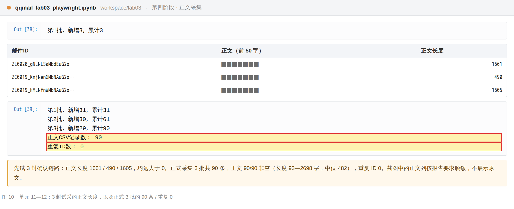

图 10：单元 11 试采 3 封的正文长度为 1661 / 490 / 1605（均远大于 0，正文列显示为"正文已脱敏"），单元 12 正式采集输出 `正文CSV记录数： 90`、`重复ID数： 0`。图中未出现任何真实姓名、邮箱或正文原文。

说明：怎样确认保存的是正文，而不是主题、摘要或整个页面？正文含换行时怎样统计邮件记录数？

答：三点确认。① 选择器指向详情页阅读窗格里专门装正文的 `div.mail-detail-content`，与列表行的 `.mail-subject`（主题）、`.mail-digest`（摘要预览）在 DOM 层级和 class 上都不同，不是同一个节点。② `inner_text()` 取的是该容器渲染后的文字，实测长度 93~2698 字、含多段换行，而主题/摘要只有几十字，且单元 11 的 3 封长度 1661 / 490 / 1605 与详情页可见文字量对应。③ 正文含换行时**绝不能用文本行数**统计邮件数，统一交给 pandas：`to_csv` 会把单元格内换行正确引用，`read_records()` 回读后 `len(detail_df)` 仍是 90 行（每行一封），`detail_df["邮件ID"].duplicated().sum()` 为 0；正文里有多少换行都不会把记录数算多。

### 3. 选做：附件下载

- 是否选做：**已选做**（单元 13，`In [43]`）
- 选做试采CSV：`private_data/mail_attachments_trial.csv`（3 行，其中 2 行「附件文件」列非空）
- 使用的附件类型：列表前 3 封中的 `.zip` 附件；文件名不写出，落盘时统一加 `01_`、`02_` 序号前缀
- 成功下载文件数：**9 个 .zip**，分属 2 封邮件（一封 5 个、一封 4 个），落在 `private_data/attachments/<邮件ID>/<随机8位>/`
- 文件大小及完成状态：全部下载完成，实测 33,214 ~ 42,769 字节；`expect_download` + `save_as` 会等待下载落盘后才返回
- 没有附件的邮件如何处理：`cards = page.locator(ATTACH_CSS)`，`if await cards.count() == 0: return ""` → 附件列写空字符串，不建目录、不报错

**选择器与下载流程（均经实测）**：`ATTACH_CSS = ".mail-detail-attach-card"`（每张附件卡片，实测命中 1 张、773 × 44），`DOWNLOAD_TEXT = "下载"`（卡片内按钮文字，唯一且可见）；用 `async with page.expect_download(timeout=90000)` **先监听再点击** `card.get_by_text(DOWNLOAD_TEXT, exact=True).click()`，再用 `download.suggested_filename` 取文件名、`download.save_as(target)` 落盘，路径按 `relative_to(PRIVATE)` 记入 CSV。另用一次真实下载预验证（`.zip`、74709 字节，存临时目录验证后删除）确认整条链路可用。

**一处需要如实说明的观察**：正式单元 13 的 `max_mails=3` 采的是列表最前 3 封，本次其中 2 封带附件、1 封没有；而一个按**列表索引**取第 28 封的临时诊断格输出 `附件数: 0`。原因是 `collect_batches()` 每次会 `inbox.click()` 并 `scrollTop = 0`，虚拟列表重新渲染后行顺序与可见区间改变，索引不是稳定标识 —— 正式代码一律用 `data-mailid` 定位，正是为了避开这个问题。该临时诊断格不属于作业内容，已删除，不影响单元 13 的结论。

⚠️ 9 个附件是真实文件，只保留在本地 `private_data/`，不上传 GitHub；公开 CSV 中附件列一律留空或写脱敏代号，不写真实文件名。

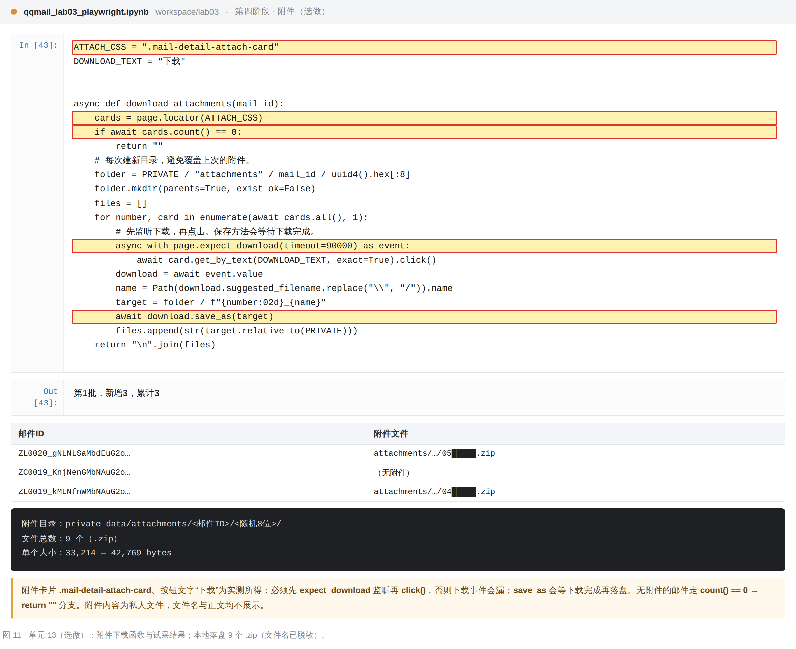

图 11：单元 13 的完整 `download_attachments` 函数，红框标出 `ATTACH_CSS`、`cards.count() == 0` 提前返回、`page.expect_download(...)` 先监听再点击、`download.save_as(target)`；输出为试采 3 封的「附件文件」列（文件名与邮件ID 均打码）与本地落盘摘要（9 个 `.zip`、33,214—42,769 字节）。未展示任何真实文件名或邮箱。

## 问题与解决

- 遇到的问题、定位过程、修改及实测结果：

  1. **安装报 `E_TIMEOUT`**：安装脚本开头 `docker info` 写死 15 秒超时，Docker 瞬时慢被误判为不可用。原样重跑安装脚本后通过，未动容器/卷/镜像。
  2. **单元 2 长时间无输出**：邮箱初始界面为英文，左侧是 `Inbox`，代码等的 `收件箱` 永不出现；且旧单元仍在 `wait_for(600000)` 中排队，新单元显示 `[*]` 却不执行。处理：把邮箱界面切为简体中文，点工具栏 ■ 中断清掉排队单元，F12 查得左侧容器为 `div.sidebar-menus`（旧版 `#folder` 不存在），填入后重跑输出 `登录成功`。
  3. **邮箱卡片在 F12 中搜不到**：卡片是悬停后延迟约 1.5 秒才动态创建、移开鼠标即从 DOM 移除的浮层，Elements 的 Ctrl+F 只能搜到摘要预览里的地址。处理：改用 Playwright 诊断格在页面内遍历 class 含 `popup/hover/card/float` 的容器，定位到 `.xmail-ui-popup-wrap` / `.xmail-cmp-account-card`，再在卡片内部找到只装邮箱地址的叶子 `.cmp-email-address`。
  4. **单元 5 从第 2 封起 `TimeoutError: waiting for locator(".cmp-email-address") to be visible`**：连到运行中的内核复刻连续 3 封流程，发现第 1、3 封卡片正常、第 2 封卡片根本没创建；对 5 个候选悬停元素各跑连续 5 封实测，`.mail-sender` 仅 3/5，`.xmail-cmp-account`、`.cmp-account-wrap`、`.cmp-account-nick`、`.senders-list` 均 5/5。把单元 3 的 `HOVER_CSS` 改为 `.xmail-cmp-account`（只改这一个填空值，未改指导书代码结构），用完整 `read_list_mail` 循环复测 `RECORDS_OK 10 FAILS []`，随后重跑单元 3、4、5 得到 `成功采集： 10`，单元 6 回读 10 行 4 列。
  5. **单元 10 需要自己找正文容器与返回控件**：点开邮件后 URL 仍是 `#/list/1`、`page.frames` 只有 1 个，说明是同页阅读窗格而非新页面或 iframe。连内核枚举可见容器，找到唯一 `div.mail-detail-content`（1216 × 1573）和唯一「返回」按钮；实测点返回后 45 行列表恢复，据此填入 `BODY_CSS`、`BACK_TEXT`。另确认 `wait_for(state="attached")` 的必要性（正文必然超出视口），单元 11 / 12 分别采到 3 封与 90 封，正文 90/90 非空。
  6. **单元 13 附件索引漂移**：最初按列表索引 28 找到带附件邮件并实测下载成功；单元 13 跑完后重新 `get_ids()` 再按索引 28 定位，读到的是另一封无附件邮件（输出 `附件数: 0`）。根因是 `collect_batches()` 每次 `inbox.click()` + `scrollTop = 0` 让虚拟列表重排，索引不稳定。处理：正式代码坚持用 `data-mailid` 定位（`get_row`），该临时诊断格删除；单元 13 本身按 `max_mails=3` 正常采到 3 封、下载 9 个 `.zip`。

- 尚未解决的问题或未完成步骤：四个阶段与选做单元 13 的代码、数据、三份公开 CSV、11 张脱敏截图与报告抬头**均已完成**，无遗留的技术问题；提交前的输出清理也已完成（单元 5 / 6 / 11 / 13 中含真实邮件内容的输出已 Clear Outputs），GitHub 上的 Notebook、图片与数据均已核对可正常打开，学习通提交链接已备好待任务发布后提交。

## 思考题

1. 人工扫码完成了什么？程序如何判断已经登录？为什么不能只用固定等待？

   答：人工扫码用自己的手机 QQ 完成身份认证并授权网页登录，这一步无法由程序代替（涉及账号与二次确认）。程序不判断"二维码被扫过"，而是等待只有登录成功后才会出现的"收件箱"元素：`page.locator("div.sidebar-menus").get_by_text("收件箱", exact=True)` 配合 `wait_for(timeout=600000)`，元素出现即认为已登录并可以继续点击。固定等待不可行：扫码耗时由人决定，短了会在登录完成前误判失败，长了既拖慢流程又不能保证那一瞬间确实处于登录态；显式等待把"状态"作为条件，快慢自适应且有明确依据。

2. 为什么按邮件ID去重，而不按发件人或主题？结合自己的实测说明。

   答：发件人和主题都可能重复 —— 本次采集的 10 封里就有多封来自同一发件人、主题完全相同，按它们去重会误删不同邮件；`data-mailid` 是列表行自带的唯一属性，同一封邮件无论滚动到哪一批都保持不变，因此适合作为跨批次去重键。第二阶段的 `get_ids()` 已用 `evaluate_all()` 一次读出整批 `data-mailid` 并在 `get_row()` 中按 ID 重新定位元素。第三阶段实测：3 批 31 / 30 / 29 共 90 条，`mail_pages.csv` 唯一 ID 90、重复 0；单元 9 用同一份 `seen_ids` 重放前 5 个 ID，新增 0 条且 `before == page_path.read_bytes()` 为 `True`。第四阶段独立重采 90 封，`mail_details.csv` 的 `duplicated().sum()` 同样为 0。单元 13 的索引漂移现象也反证了这一点：列表顺序会变，只有 `data-mailid` 稳定。

3. 列表摘要和详情正文有什么区别？返回列表后如何避免失效元素和漏采？

   答：列表摘要（`.mail-digest`）只是一行的预览文字，通常几十字且被截断；详情正文是点开后阅读窗格里 `.mail-detail-content` 的完整内容，含多段换行，本次实测 93~2698 字（中位 482）。返回列表后旧的元素对象会失效：QQ 邮箱是虚拟列表，滚动或切换视图会卸载不可见行，若把 `locator` 存下来复用就会找不到节点。本实验的做法是：不保存元素对象，`get_ids()` 一次读出整批 `data-mailid`，每封用 `get_row(mail_id)` 重新定位；`read_detail()` 用 `finally` 保证一定点「返回」、`evaluate(... scrollTop, top)` 恢复到进入详情前的滚动位置，再 `get_row(mail_id).wait_for(state="attached")` 等该行重新挂载才继续下一封。这样既不会漏采，也不会把上一封的正文或悬停卡片串到下一封；90 封全部采到正文、重复 ID 为 0 就是验证结果。

4. 结合所选工具，说明一次真实问题的定位与修改。若使用AI，写明哪些建议经过自己的运行核对。

   答：真实问题是单元 5 从第 2 封开始报 `TimeoutError: waiting for locator(".cmp-email-address") to be visible`，但第 1 封能成功。定位过程用了 Playwright 自身做诊断而非盲改代码：连到运行中的 Jupyter 内核，写一个临时诊断格逐个复刻 `read_list_mail` 的每一步（`TIME_CSS.hover()` → 等卡片 hidden → 滚动 → 等滚动停止 → hover → 等 visible），打印每一步 `EMAIL_CSS` 的元素数和 `is_visible()`；结果显示卡片是悬停后延迟约 1.5 秒动态创建的全局单例，第 2 封 hover 后元素数为 0 且 2.5 秒后仍未创建，说明 `mouseenter` 没被触发，而不是选择器写错或等待时间不够。再把 5 个候选元素各跑连续 5 封做对照实验，得到 `.mail-sender` `[1,0,1,1,0]`、其余四个 `[1,1,1,1,1]`；结合卡片类名 `.xmail-cmp-account-card` 判定应悬停账号组件本身。修改只动单元 3 一个填空值 `HOVER_CSS = ".xmail-cmp-account"`，指导书给出的函数结构、其余填空、单元 5 循环一字未改；改后完整循环 10 封零失败、CSV 回读 10 行 4 列。

   AI 提供了选择器候选、诊断格思路与改法建议；**所有建议都经过本人运行核对**：F12 逐一查证 DOM 结构、每个单元亲自粘贴运行、5 个候选逐个实测对比、确认 10 封全通过后才采用，诊断格用完即删除，未采用"改代码结构"或"加额外代码行"的建议。第三、四阶段同样如此：`SCROLL_CSS` 由连内核枚举可滚动元素（实测 `clientHeight 822` / `scrollHeight 11475`）后确定；`.mail-detail-content`、「返回」、`.mail-detail-attach-card`、「下载」均在真实详情页逐一验证唯一性、可见性与一次真实下载后才填入。

## 最终统一提交检查

- [x] 四阶段在同一份报告中，已区分必做和选做；未完成项如实说明。（单元 1—13 全部完成，选做单元 13 已标注）
- [x] 原仓库 `lab03/` 中包含自己补全的 `qqmail_lab03_playwright.ipynb`、三份公开CSV、报告和脱敏截图 —— notebook、报告、三份原始 CSV、正文与附件、`data/*_public.csv`、`images/` 下 11 张脱敏截图均已就位，本报告已用相对路径嵌入全部图片
- [x] 原始邮件、正文和私人附件保留在本地，未上传Cookie、登录态文件、账号密码、`.env`或认证连接地址（`private_data/` 已被 `.gitignore` 忽略）
- [x] Notebook输出已检查并清理，GitHub上的图片和数据能正常打开 —— 单元 5 / 6 / 11 / 13 中含真实邮件内容的输出已执行 Clear Outputs，上传版本不含原始邮件正文与附件
- [x] 四阶段结束后已统一上传实验三至原作业仓库 `https://github.com/CCR-CR-RRRC/bigdata-collection-labs-112404260121/tree/master/lab03`；学习通提交所用的仓库链接已备好，待老师发布任务后直接提交

数据和截图的脱敏方法；各CSV之间怎样保持ID及字段对应关系：

答：脱敏方法 —— 截图先裁掉或打码浏览器地址栏（Jupyter 的 `token=`、noVNC 的 `#password=`），再打码邮件列表、CSV 表格中的发件人、邮箱地址、主题、正文；报告里的样本只用"第 N 条"等位置代号，公开 CSV 用脱敏代号或中性假值替换四个字段，绝不把 `private_data/` 的原始 CSV 复制进提交目录。附件同理：`private_data/attachments/` 只在本地保存，公开 CSV 中附件列一律留空或写脱敏代号，不写真实文件名。ID 对应关系 —— 以列表行的 `data-mailid` 作为唯一键：第二阶段按指导书 `BASIC_COLUMNS` 只输出 4 列（不含邮件ID），第三阶段 `mail_pages.csv` 起保留"邮件ID"列（5 列），第四阶段 `mail_details.csv` 为 7 列（含正文、附件文件），选做的 `mail_attachments_trial.csv` 同为 7 列；跨 CSV 关联一律按"邮件ID"匹配，不按发件人、主题或列表索引匹配；每次采集都用 `get_ids()` 重新读取整批 ID、按 ID 重新定位行，避免列表刷新后旧元素失效导致字段串位。

如使用AI，简述它帮助了什么，以及自己编写、修改、运行和核对了什么：

答：AI 帮助分析了 QQ 邮箱的页面结构、给出了各字段选择器的定位思路和四个阶段的函数框架，并协助排查了英文界面导致登录等待超时、`HOVER_CSS` 悬停落点偏导致第 2 封起卡片等待超时两个问题。本人完成了全部代码的输入与运行：手机扫码登录并将界面切换为中文、F12 逐层查证 DOM 结构、试采 10 封并保存回读 CSV、3 批滚动采集 90 条并核对唯一 ID 90 / 重复 0、同一次运行内重放 5 个 ID 验证去重、试采 3 封正文后全量采集 90 封正文（90/90 非空、中位 482 字）、选做附件下载 9 个 .zip，并对第 1 / 5 / 10 条样本逐字段与网页核对后才定稿。
